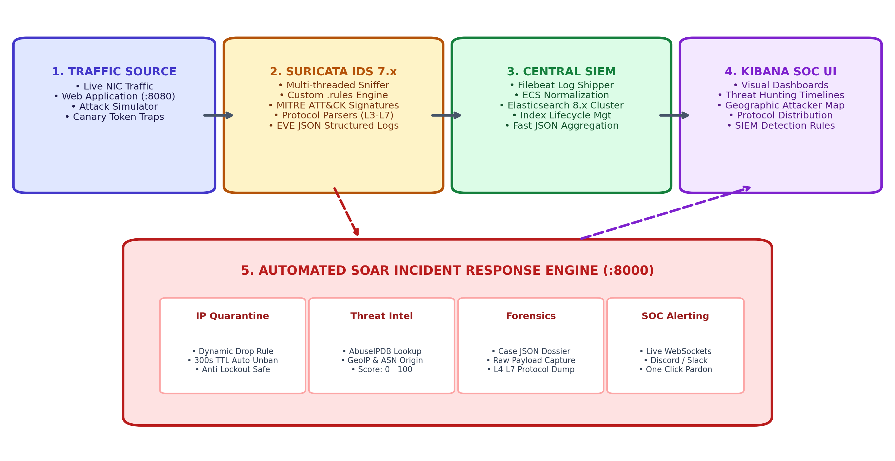
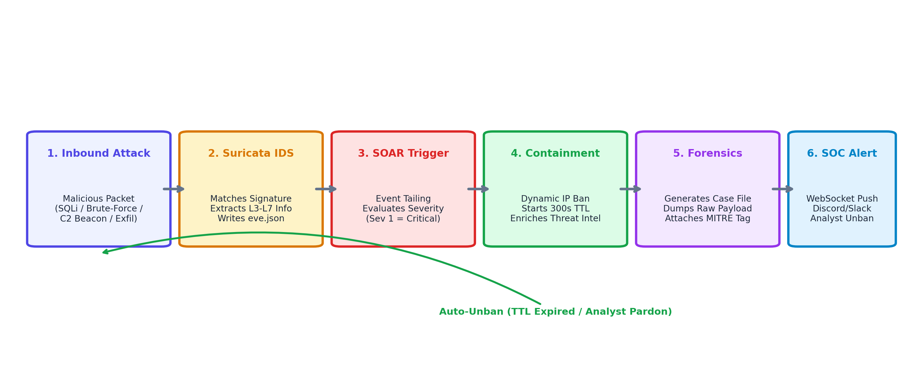

<div align="center">

# Suricata-Driven SIEM with Automated Incident Response (SOAR)
### *Autonomous Network Intrusion Detection, Elastic SIEM Correlation, and Kernel-Level Containment*

[](LICENSE)
[](https://python.org)
[](https://suricata.io)
[](https://elastic.co)
[](https://elastic.co)
[](https://docker.com)
[](docs/MITRE_ATTACK_MAPPING.md)

[Overview](#-overview) •
[Why Docker](#-why-docker-is-used-in-this-project) •
[Architecture](#-system-architecture) •
[SOAR Internals](#-soar-engine-internals--equations) •
[Threat Matrix](#-mitre-attck-threat-matrix) •
[Quickstart](#-quickstart-guide) •
[Tests & Benchmarks](#-testing-verification--empirical-benchmarks) •
[Repo Structure](#-repository-structure)

</div>

---

## 📌 Overview

The **Suricata-Driven SIEM + SOAR Platform** is an autonomous cyber-defense testbed that bridges **network intrusion detection (Suricata 7.0)**, **SIEM log analytics (Filebeat + Elasticsearch + Kibana 8.12)**, and **automated sub-second containment (FastAPI SOAR Engine + Linux netfilter `iptables`)**.

Standalone IDS deployments flood analysts with raw alerts and require slow manual firewall intervention, yielding long **Mean Time to Respond (MTTR)** windows. This platform closes that loop automatically:

1. **Captures Live Target Traffic via `AF_PACKET` (`eth0`):** Multi-threaded Suricata (`threads: 4`, `cluster-id: 99`, checksum offload validation off via `-k none`) inspects all ingress and egress traffic across 27 custom MITRE ATT&CK signatures and writes structured alerts to `eve.json`.
2. **Normalizes & Indexes into SIEM (`ECS`):** Filebeat ships `eve.json` to Elasticsearch 8.12 using Elastic Common Schema mappings (`source.ip`, `destination.ip`, `rule.name`, `event.severity`) for Kibana threat hunting.
3. **Executes Autonomous Containment (`Severity <= 1`):** The SOAR engine asynchronously tails `eve.json` every `200 ms`, resolves true attacker IPs even on reverse-flow server response signatures (e.g., HTTP 401 brute-force alerts), protects infrastructure via an allow-list, and inserts kernel firewall `DROP` rules (`iptables -I INPUT 1 ...`) with self-healing **300s TTL expiration**.
4. **Enriches IOCs & Chains Forensic Evidence:** Computes weighted Threat Intelligence reputation scores, assembles append-only SHA-256 **hash-chained case dossiers** (`CASE-*.json`), and broadcasts live WebSocket updates to a clean **light-mode SOC Operations Center** with interactive toast notifications and one-click Pardon/Ban controls.

---

## 🐳 Why Docker Is Used in This Project

Docker is not just used for packaging here — several core security guarantees of the architecture rely directly on **Linux container primitives and Docker networking**:

1. **Shared Network Namespace (`network_mode: "service:vulnerable-target"`):**
   In [docker-compose.yml](docker-compose.yml), `suricata` and `soar-engine` explicitly attach to `vulnerable-target`'s network namespace:
   - `siem-suricata` inspects the exact same `eth0` interface (`172.28.0.10`) as the target web/SSH application, ensuring 100% packet visibility without external span ports or host promiscuous hacks.
   - `siem-soar-engine`'s `iptables` rules execute inside `vulnerable-target`'s own network stack (`INPUT` and `FORWARD` chains), so quarantined attacker IPs are dropped inside the Linux kernel **before packets ever reach Flask/SSH sockets**.
2. **Isolated Non-NATted Virtual Lab Subnet (`siem_net` `172.28.0.0/16`):**
   Dedicated client containers run with static IP addresses — `lab-attacker-auth` (`172.28.0.105`), `lab-attacker-c2` (`172.28.0.200`), and `lab-benign` (`172.28.0.50`) — preserving real source IPs across packets (no NAT masquerading) for reproducible case studies, whitelist enforcement (`172.28.0.1`, `172.28.0.10`), and collateral-free benign traffic verification.
3. **Least-Privilege Linux Kernel Capabilities (`cap_add`):**
   Instead of running everything unsafely on the host OS, Docker grants scoped capabilities only where needed: `[NET_ADMIN, NET_RAW, SYS_NICE]` for Suricata `AF_PACKET`, and `[NET_ADMIN, LINUX_IMMUTABLE]` for SOAR kernel firewall bans and append-only (`chattr +a`) forensic dossiers.
4. **Enforced Resource Budgets (`mem_limit`):**
   Matches strict memory constraints (`elasticsearch: 2g` with `512m` JVM heap, `suricata: 1g`, `soar-engine: 512m`) and binds management ports (`9200`, `5601`) strictly to `127.0.0.1`.
5. **Cross-Platform Stack Reproducibility:**
   Bundles Suricata 7.0.17, Elasticsearch 8.12.0, Kibana 8.12.0, Filebeat 8.12.0 (`--strict.perms=false`), Python 3.11 services, and Linux `iptables` in one `docker compose up -d --build` workflow — working cleanly on Linux and Windows Docker Desktop (including container-local `/mnt/suricata` config staging so read-only host mounts never block Suricata entrypoint `chown`).

> **Standalone Fallback:** For quick UI/API demos or Windows environments where Docker Desktop is stopped, [run_local_demo.py](run_local_demo.py) (`START_PROJECT.bat`) runs the FastAPI SOAR hub (`:8000`) and Flask Target Portal (`:8080`) natively using `MockKernelBackend`.

---

## 🏗️ System Architecture

The 9-container orchestration implements a decoupled 5-tier pipeline:

<div align="center">



</div>

1. **Traffic & Client Tier:** `vulnerable-target` (`172.28.0.10`, exposing HTTP `:8080->80` and SSH `:2222->22`) plus isolated client containers (`lab-attacker-auth`, `lab-attacker-c2`, `lab-benign`).
2. **IDS Capture Tier (`siem-suricata`):** `jasonish/suricata:7.0` using `AF_PACKET` (`cluster-id: 99`, `threads: 4`, checksum checks disabled) reading all 6 custom rulesets into shared `suricata_logs` (`eve.json`).
3. **SIEM Log Pipeline (`siem-filebeat` → `siem-elasticsearch`):** Tails `/var/log/suricata/eve.json`, enriches ECS fields, and indexes streams into `suricata-events-*`.
4. **SOC Visualization (`siem-kibana`):** Dashboards and Discover threat hunting at `http://localhost:5601` using [config/kibana/dashboards/suricata_siem_dashboards.ndjson](config/kibana/dashboards/suricata_siem_dashboards.ndjson).
5. **Autonomous SOAR Engine (`siem-soar-engine`):** Event-driven FastAPI + WebSocket orchestrator (`http://localhost:8000`) coordinating containment, TI scoring, forensic hashing, and real-time UI updates.

---

## ⚙️ SOAR Engine Internals & Equations

<div align="center">



</div>

### Key Modules Implemented
- **Quarantine State Machine ([soar_engine/ban_manager.py](soar_engine/ban_manager.py)):**
  - Enforces explicit states `ACTIVE` → `EXPIRED` | `PARDONED` backed by SQLite (`bans.db`) and an append-only audit ledger (`audit.jsonl`).
  - Strict IP validation (`ipaddress.ip_address`), IPv4 (`iptables`) + IPv6 (`ip6tables`) support, `INPUT` + `FORWARD` chain rules tagged `-m comment --comment siem-soar`, `MAX_ACTIVE_BANS=1000` capacity guard, and **startup reconciliation** (re-arms valid bans, expires stale bans, and prunes orphaned kernel rules).
  - Pre-ban infrastructure allow-list protecting gateways, target host (`172.28.0.10`), loopback ranges (`127.0.0.0/8`, `::1/128`), and `/etc/resolv.conf` DNS resolvers.
- **Reverse-Flow Offender Attribution ([soar_engine/engine.py](soar_engine/engine.py)):**
  - Server-response signatures like `sid:1000012` (`flow:established,to_client` HTTP `401`) emit the target IP as `src_ip` and the attacker as `dest_ip`. `SOAREngine.resolve_offender_ip()` detects these rules and resolves the true attacker IP (`dest_ip`) so the target never tries to ban itself.
- **Threat Intelligence Formula ([soar_engine/playbooks/threat_intel.py](soar_engine/playbooks/threat_intel.py)):**
  - Computes weighted reputation:
    $$R(x) = w_1 \cdot \text{AbuseIPDB}(x) + w_2 \cdot \text{ASN}(x) \quad (w_1 = 0.7,\; w_2 = 0.3)$$
  - Queries live AbuseIPDB when configured for public IPs and uses a explicitly labelled `local_ioc_cache` for RFC1918 / lab subnet IPs (`172.28.0.105`, `172.28.0.200`, `198.51.100.*`, `203.0.113.*`).
- **Hash-Chained Forensic Dossiers ([soar_engine/dossier.py](soar_engine/dossier.py)):**
  - Writes structured records $D = \langle \text{CaseID}, t, \text{alert}, R(x), \text{payload}, \text{SHA256} \rangle$ chained sequentially via `prev_sha256` in `ledger.jsonl`, hardened with `chattr +a` on Linux, and cryptographically verifiable via `GET /api/forensics/verify`.
- **REST & WebSocket Control Plane ([soar_engine/app.py](soar_engine/app.py) & [soar_engine/static/index.html](soar_engine/static/index.html)):**
  - Endpoints: `POST /api/bans`, `DELETE /api/bans/{ip}` (awaits kernel rule removal before returning), `POST /api/bans/{ip}/extend`, `GET /api/threat-intel/{ip}`, `GET /api/forensics/verify`, `GET /api/audit-logs`, `POST /api/policy`, `GET/POST /api/simulate/{scenario}`, and `/ws/live` WebSocket broadcasts (`BAN_ACTIVE`, `BAN_EXPIRED`, `BAN_PARDONED`).
  - **Light-mode SOC Web UI** with live action toast notifications, active firewall table, policy controls, and ablation toggles (`ENABLE_TTL`, `ENABLE_THREAT_INTEL`, `ENABLE_ECS`, `ENABLE_FORENSICS`, `ASYNC_MODE`).

---

## 🎯 MITRE ATT&CK Threat Matrix

All 6 threat classes (27 Suricata signatures total) are configured with `priority:1` to enforce **100% automated auto-quarantine** under Eq. 8:

| # | Threat Scenario | MITRE Tactic & ID | Detection Thresholds & Rule File | Automated SOAR Action |
|:---:|---|---|---|---|
| **1** | **Network Reconnaissance** | `TA0043` / `T1595.001` | $\ge 10$ ports in $\le 5$s (`sid:1000001`, [recon.rules](config/suricata/rules/recon.rules)) | **Auto-Ban (300s TTL)** + TI + Chained Dossier |
| **2** | **Authentication Attacks** | `TA0006` / `T1110.001` | $\ge 5$ HTTP `401` in $\le 10$s / SSH bursts (`sid:1000012`, [auth_bruteforce.rules](config/suricata/rules/auth_bruteforce.rules)) | **Auto-Ban (300s TTL)** (reverse-flow resolved) + TI + Dossier |
| **3** | **Web Application Exploits** | `TA0001` / `T1190`, `T1059` | SQLi (`UNION SELECT`), XSS, Traversal, Cmd Injection (`sid:1000020–1000025`, [web_attacks.rules](config/suricata/rules/web_attacks.rules)) | **Auto-Ban (300s TTL)** + TI + Dossier |
| **4** | **Malware C2 Communication** | `TA0011` / `T1071.001` | Periodic beacon every `3.0s` to `/api/v1/heartbeat` (`sid:1000030`, [malware_c2.rules](config/suricata/rules/malware_c2.rules)) | **Auto-Ban (300s TTL)** + C2 Botnet TI Tag + Dossier |
| **5** | **DNS Tunneling Exfiltration** | `TA0010` / `T1048.003` | Query name $> 50$ B / Base64 label / TXT flood (`sid:1000040–1000042`, [dns_exfil.rules](config/suricata/rules/dns_exfil.rules)) | **Auto-Ban (300s TTL)** + TI + Dossier |
| **6** | **Sensitive Data Exfiltration** | `TA0010` / `T1048` | `POST` $> 5{,}000$ B (`filename=`), `.sql`/`.zip`/`.kdbx`, `BEGIN RSA PRIVATE KEY` (`sid:1000050–1000052`, [data_exfil.rules](config/suricata/rules/data_exfil.rules)) | **Auto-Ban (300s TTL)** + Forensic Evidence Capture |

---

## 🚀 Quickstart Guide

### Option A: Full Docker Compose Cluster (Real Suricata `AF_PACKET` + Kernel `iptables` + Kibana)
Requires Docker Desktop (Windows/macOS) or Docker Engine + Compose v2 (Linux):

```bash
git clone https://github.com/sajeevnetworksolutions-lgtm/suricata-driven-siem-soar.git
cd suricata-driven-siem-soar

# Build and start all 9 containers
docker compose up -d --build
docker compose ps
```

- **SOAR Operations Center:** http://localhost:8000
- **Interactive Target & Attack Portal:** http://localhost:8080
- **Kibana SIEM:** http://localhost:5601 *(Import [config/kibana/dashboards/suricata_siem_dashboards.ndjson](config/kibana/dashboards/suricata_siem_dashboards.ndjson) via Stack Management → Saved Objects)*
- **Elasticsearch:** http://localhost:9200

Verify live kernel enforcement end-to-end inside Docker:
```bash
python benchmarks/verify_docker_enforcement.py
```

---

### Option B: Standalone Windows / Local Mode (Zero Docker Required)
On Windows, double-click **`START_PROJECT.bat`** (stops with **`STOP_PROJECT.bat`**), or run from any terminal:

```bash
pip install fastapi uvicorn requests flask jinja2 pydantic websockets reportlab psutil numpy pandas scipy pytest
python run_local_demo.py --open-browser
```
Opens **SOAR (`http://localhost:8000`)** and **Target Portal (`http://localhost:8080`)** using `MockKernelBackend`.

---

## 🧪 Testing, Verification & Empirical Benchmarks

### 1. Automated Unit & API Test Suite (25 Tests)
```bash
python -m pytest tests -v
```
- **Observed Result:** **25 / 25 passed** covering `BanManager` state machine (`ACTIVE`/`EXPIRED`/`PARDONED`, 300s TTL, whitelist rejection, IPv6 & injection checks, startup orphan pruning, capacity limit, `no_ttl` permanent bans), `Dossier` Eq. 12 hash-chain verification, TI weighted formula, FastAPI endpoints + WebSocket broadcasts, reverse-flow `sid:1000012` attribution, and Phase 2 benchmark matching/tailer/statistics checks.

### 2. Live Docker Enforcement Check
```bash
python benchmarks/verify_docker_enforcement.py
```
- **Observed Result against Running 9-Container Stack:**
  - `suricata -T`: **6 rule files processed, 27 rules loaded, 0 failed**.
  - Shared `eth0` (`172.28.0.10/16`) confirmed on `siem-soar-engine`.
  - Firing `auth_bruteforce.py` from `lab-attacker-auth` (`172.28.0.105`) triggered HTTP `401` on Attempt 1, Suricata alerted on `eth0`, SOAR injected `-A INPUT -s 172.28.0.105/32 -m comment --comment siem-soar -j DROP`, and Attempts 2–5 + probes timed out in the Linux kernel while `lab-benign` (`172.28.0.50`) remained unaffected (`HTTP 200`).
  - `DELETE /api/bans/172.28.0.105` restored connectivity (`200`), 300s auto-TTL expiration (`TTL_EXPIRED`) verified cleanly (`-P INPUT ACCEPT`), and Filebeat indexed `127` ECS events into a `green` Elasticsearch cluster (`avg_mttd_ms: 55.24 ms`, `avg_response_time_ms: 181.53 ms`).

### 3. Reproducible 5×100 Benchmarks, Ablations & Statistical Tests
Run locally (via [benchmarks/run_benchmarks.py](benchmarks/run_benchmarks.py) + [benchmarks/run_baselines.py](benchmarks/run_baselines.py) + [benchmarks/compute_stats.py](benchmarks/compute_stats.py)) or against Docker containers ([Makefile](Makefile) + [benchmark/run_benchmark.py](benchmark/run_benchmark.py) + [benchmark/run_ablations.sh](benchmark/run_ablations.sh)):

```bash
# Local 5 rounds x 100 cycles + 10,000 benign requests + baselines + scipy stats (alpha=0.001)
python benchmarks/run_benchmarks.py --rounds 5 --cycles 100 --benign-count 10000 --ingest-path eve --variant all
python benchmarks/run_baselines.py --rounds 5 --cycles 100
python benchmarks/compute_stats.py --alpha 0.001

# Containerized Phase 2 Makefile targets (with Docker stack up)
make test
make up && make quick
make bench && make ttl && make ablate && make report
```

#### Measured Local 5×100 Results ([benchmarks/results/statistical_report.md](benchmarks/results/statistical_report.md))
*Measured on Windows local `ManagedStack` (200 ms `eve.json` tailer + `MockKernelBackend`); full benign mix verified on `full` (`10,000` requests = `7,000` HTTP `200` + `3,000` UDP DNS, `0` errors, `0.0%` FPR). Ablation runs executed `500` DNS benign checks each (`0.0%` FPR). `snort_manual` is explicitly labelled `modelled`.*

| Series | Type | n | Recall % | Contain % | MTTD Mean (ms) | MTTR Mean (ms) | MTTR SD (ms) | p95 MTTR (ms) | Forensic Mean (ms) | Welch t p-value | Wilcoxon p-value |
|---|---|---:|---:|---:|---:|---:|---:|---:|---:|---:|---:|
| `full` | `soar_variant_measured` | 500 | 100.0 | 100.0 | 176.974 | 45.617 | 17.899 | 66.212 | 25.436 | — | — |
| `no_async` | `soar_variant_measured` | 500 | 100.0 | 100.0 | 98.794 | 56.715 | 18.905 | 89.322 | 42.993 | `1.14e-20` | `3.14e-40` |
| `no_ecs` | `soar_variant_measured` | 500 | 100.0 | 100.0 | 172.290 | 74.758 | 40.978 | 149.110 | 53.454 | `4.43e-42` | `8.95e-70` |
| `no_forensics` | `soar_variant_measured` | 500 | 100.0 | 100.0 | 176.700 | 20.962 | 38.778 | 31.479 | 0.000 | `2.34e-34` | `5.43e-81` |
| `no_ti` | `soar_variant_measured` | 500 | 100.0 | 100.0 | 176.867 | 63.158 | 32.849 | 91.226 | 39.797 | `3.89e-24` | `2.16e-59` |
| `no_ttl` | `soar_variant_measured` | 500 | 100.0 | 100.0 | 176.866 | 63.824 | 32.293 | 125.878 | 39.664 | `2.26e-26` | `1.13e-41` |
| `snort_manual_modelled` | `baseline_modelled` | 500 | 100.0 | 0.0 | 8511.050 | 64577.900 | 9576.308 | 81750.867 | 0.000 | `0.00e+00` | `1.26e-83` |

- `suricata_elk_only` baseline (`500` measured detection cycles, no auto-ban): Mean MTTD `71.741 ms` (`SD = 50.358 ms`), `0.0%` automated containment.

---

## 📁 Repository Structure

```text
suricata-driven-siem-soar/
├── docker-compose.yml              # 9-container stack (shared target/Suricata/SOAR netns + ES + Kibana + Filebeat + lab clients)
├── docker-compose.bench.yml        # Host bind-mount override for containerized Phase 2 benchmarks
├── Makefile                        # Wrapper targets: test, up, quick, bench, ttl, ablate, report
├── README.md                       # Complete project architecture, Docker rationale, and benchmark report
├── README_PHASE2.md                # Phase 2 containerized benchmark protocol instructions
├── START_PROJECT.bat / STOP_PROJECT.bat # Windows 1-click local launcher & teardown
├── run_local_demo.py               # Standalone Windows/Linux runner (:8000 SOAR + :8080 Target)
├── run_and_test.py                 # In-process end-to-end integration test runner
├── test_verification.py            # Live 6-scenario + whitelist + dossier + TI verification script
├── test_live_all.py                # Target button + canary trap + SOAR simulator verifier
├── config/
│   ├── suricata/
│   │   ├── suricata.yaml           # AF_PACKET (cluster-id 99, 4 threads), checksum-validation off, HOME_NET
│   │   ├── af-packet.snippet.yaml  # AF_PACKET reference configuration snippet
│   │   └── rules/*.rules           # 27 priority:1 signatures across 6 MITRE categories
│   ├── filebeat/filebeat.yml       # NDJSON EVE parser + ECS field mapping -> Elasticsearch
│   └── kibana/dashboards/          # Importable suricata_siem_dashboards.ndjson
├── soar_engine/
│   ├── Dockerfile                  # Python 3.11 + iptables + iproute2 + e2fsprogs (chattr)
│   ├── app.py                      # FastAPI REST API + /ws/live WebSocket broadcaster
│   ├── engine.py                   # Async 200ms eve.json tailer, reverse-flow resolution, ablation orchestrator
│   ├── ban_manager.py              # ACTIVE/EXPIRED/PARDONED state machine, SQLite, audit.jsonl, iptables/Mock backends
│   ├── dossier.py                  # Eq. 12 append-only SHA-256 hash-chained forensic ledger
│   ├── models.py / config.py       # Data schemas, thresholds, whitelist, ablation flags
│   ├── playbooks/                  # ip_block.py, threat_intel.py (R(x)), forensic_dump.py, notification.py
│   └── static/index.html           # Light-mode SOC Dashboard with live action toast feedback
├── target_service/app.py           # Vulnerable web portal, Auth/SQLi/C2/Exfil/Canary endpoints & interactive cards
├── attack_simulator/
│   ├── run_attack_suite.py         # Table II CLI attack suite (1-6)
│   ├── benign_traffic.py           # 10,000-request benign HTTP (70%) + UDP DNS (30%) load generator
│   └── scenarios/*.py              # Modular scenario scripts (1-6)
├── benchmark/                      # Containerized Phase 2 runner (attacks.py, run_benchmark.py, analyze.py, ablations)
├── benchmarks/                     # Local 5x100 runner, baselines, scipy compute_stats.py, verify_docker_enforcement.py & CSV results
├── tests/                          # 25 pytest unit, API, TI, dossier, and benchmark tests
├── pcaps/suricata_attack_suite.pcap # Offline PCAP capture across all 6 attack classes
└── docs/                           # Architecture diagrams, synopsis PDF, API reference, MITRE & playbook docs
```

---

## ⚖️ License

Licensed under the **Apache License, Version 2.0**. See [LICENSE](LICENSE).
